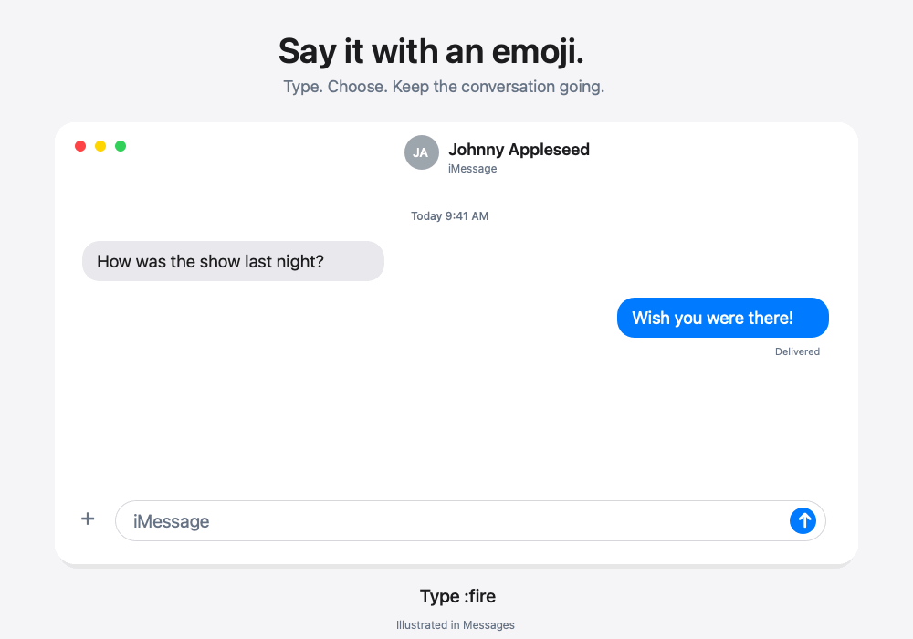
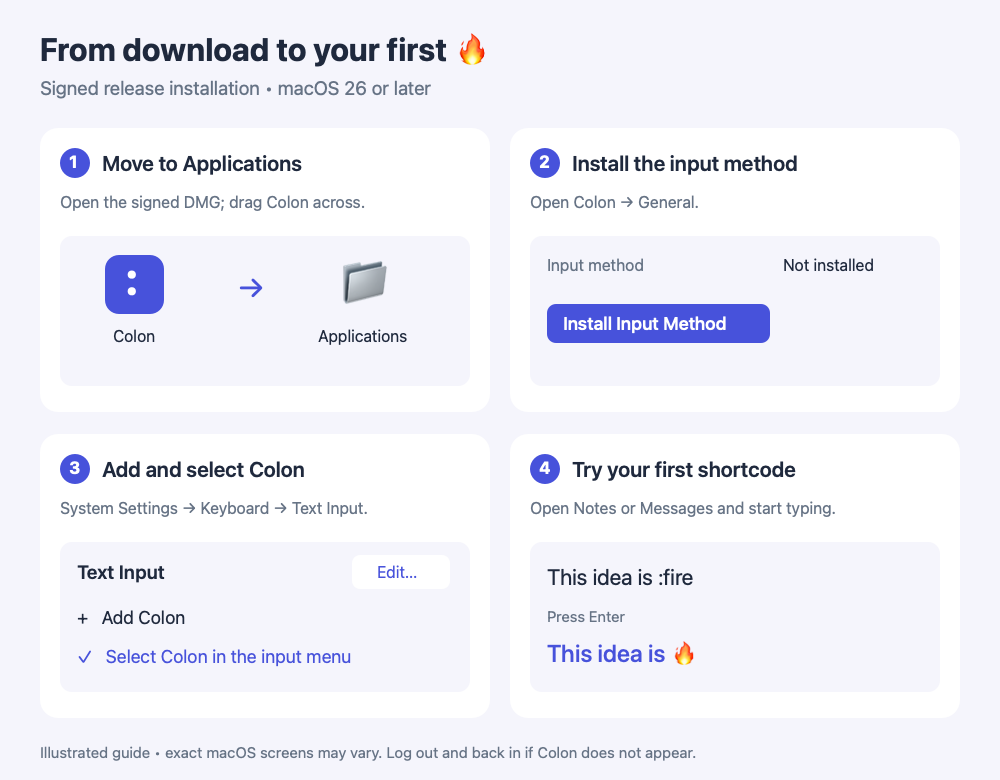

# Colon

Colon is a local, native macOS utility for Slack-style `:emoji` autocomplete.
Type a shortcode, pick an emoji, and keep writing. No accounts, analytics,
clipboard insertion, or runtime network calls.



*Illustrated demo, not a screen recording. Picker results depend on your query and
settings. [View the still image](docs/images/colon-demo-still.png).*

**Native macOS · Local by design · MIT licensed**

## Status

Version 0.2.1 is a development preview. The automated core and desktop checks are
available below. Full eight-app, secure-field, multi-display, and clean-install
acceptance remains a release gate: see [compatibility](docs/compatibility-matrix.md).
This repository does not claim a notarized public V1 or Mac App Store release.

## Install Colon

**Requires macOS 26 or later.** For the guided installation below, you need a
signed, notarized release. Check this repository’s **Releases** page for a
`Colon-VERSION-macOS.dmg` download. If there is no signed release yet, follow
[Build from source](#build-from-source) instead. GitHub’s **Code → Download ZIP**
contains source code, not an installable app; unsigned workflow artifacts are
for development.



*Illustrations show the main controls to look for; exact macOS screens may vary.*

### 1. Download and open

Download the release DMG and its `.sha256` file into the same folder. To check
that the download matches the published checksum, open Terminal in that folder
and run this command, replacing `VERSION` with the downloaded version:

```sh
shasum -a 256 -c Colon-VERSION-macOS.dmg.sha256
```

Expect an **OK** result. Open the DMG: you’ll see **Colon** and an
**Applications** shortcut. Drag Colon onto Applications, then open Colon from
Applications. If macOS asks whether to open the downloaded app, confirm **Open**.

### 2. Install the input method

In Colon’s **General** tab, find **Input method** and choose
**Install Input Method**. This installs the typing component in your user account.
The status should change to reflect installation; you may see instructions to
log out and back in before macOS discovers it.

If Colon reports an older system-wide installation, follow the
[upgrade instructions](docs/release.md#existing-system-wide-development-installations)
before continuing. Avoid installing a second copy of the input source.

### 3. Add and select Colon

Open **System Settings → Keyboard → Text Input → Edit**. Use **+** to find and add
**Colon**, then select **Colon** from the macOS input menu in the menu bar.
You can also try **Enable & Select** in Colon after installation. If macOS does
not allow this automatically, use System Settings as described above.

Return to Colon and choose **Refresh** to update its status. If Colon does not
appear in the input-source list, log out and back in, then repeat this step.
Installing the companion alone does not select the keyboard input source.

### 4. Type your first emoji

Open **Notes** or **Messages** and type `This idea is :fire`.
As you type the shortcode, a picker should appear near the caret with 🔥 selected.
Press **Enter**: the text becomes `This idea is 🔥`. Keep typing normally.
You can also type `:fire:` to commit with the closing colon.

| What you want to do | Key |
| --- | --- |
| Move through matches | ↑ / ↓ |
| Insert the selected emoji | Enter |
| Commit a matching shortcode | Closing `:` |
| Cycle skin tones for eligible emoji | Tab |
| Dismiss the picker | Escape |

If nothing appears, confirm Colon is selected in the macOS input menu and
**Enable Colon** is on in its General tab. Check that the current app is enabled
in Colon’s **Apps** tab. Try Notes or Messages first; unsupported apps and
protected fields intentionally pass typing through.

### Build from source

Install **Xcode 26 or later** and accept its license. Download and extract the
repository with **Code → Download ZIP**, or clone it. Open Terminal in the
repository folder and run:

```sh
./Scripts/ci.sh
```

This tests the project and builds unsigned apps. The companion is at
`DerivedData/Build/Products/Debug/Colon.app`; open `Colon.xcworkspace` to develop
in Xcode. To enable the input method on your own Mac, create an **Apple Development**
certificate in **Xcode → Settings → Accounts**, then run:

```sh
./Scripts/install-development-input-method.sh
```

The script signs and installs the development input method. Follow step 3 above
to add/select Colon, logging out and back in if requested. The unsigned companion’s
**Install Input Method** button is intended for signed release bundles; use the
script for this development installation. See the full
[development guide](docs/development-input-method.md) for details.

## Features and everyday use

### Find and insert emoji

Type `:` at a word boundary followed by an emoji name or alias, such as `:fire`.
The picker follows your caret without taking focus away from the app. Use **↑ / ↓**
to select a match, **Enter** to insert it, or click a result. A closing colon also
commits a match, so you can type `:fire:` straight through. **Escape** dismisses
suggestions without changing your text.

The picker prefers a position above the caret and flips below near the screen
edge. If the host cannot supply a caret position, it stays hidden. While editing
an existing query back to a bare colon or an unmatched name, the last results
remain visible but disabled until a match returns.

Standard Slack-compatible shortcodes are included as additional search tags,
merged with existing aliases and tags without duplicates. Existing aliases keep
their priority when names overlap. Workspace-specific custom Slack emoji are not
included. The pinned source is documented in [data sources](Vendor/SOURCES.md).

### Choose and remember skin tones

Type `:wave`, select the waving hand, and press **Tab** to cycle its available
skin tones. Press Tab again to move through the choices, then **Enter** or a
closing **:** to insert the chosen variant. You can also click a tone in the
skin-tone panel. Colon remembers the last successfully inserted tone **for each
emoji**, so it is ready next time. Your current choice stays selected while the
caret position refreshes. For emoji without skin-tone variants, Tab passes
through to the app normally.

### Add your own emoji tags

In **Emoji Tags**, search for an emoji, select it, enter a custom tag, and click
**Add** (or press Enter). Tags support letters, digits, underscores, plus signs,
and hyphens. For example, add `shipit` to 🚀, then search with `:shipit` while
typing. Remove a tag with its trash button. Tags stay on your Mac.

### Customize the picker

In **Appearance**, choose **System**, **Light**, or **Dark** colors and a
**Compact**, **Standard**, or **Large** picker. Set **Visible rows** from 1–12
and **Maximum results** from the visible-row count up to 100. Scroll through
longer result lists. The picker also responds to macOS Reduce Motion and
Increase Contrast preferences.

### Control where Colon runs

The **Apps** tab has individual switches for **Messages, Notes, Mail, Safari,
Google Chrome, Slack, Discord, and Notion**. Unsupported apps, disabled apps,
and protected input contexts pass typing through. This is the supported-app
policy; actual host-editor coverage is tracked in the
[compatibility matrix](docs/compatibility-matrix.md).

In **General**, turn **Enable Colon** on or off, choose **Launch companion app
at login**, and show or hide Colon’s menu bar item. The menu provides **Open
Settings**, **Enable/Disable Colon**, **Test Colon**, and **Quit Companion App**.
The **Try Colon** field in General lets you practice locally without switching
apps. Hiding the menu bar item does not disable autocomplete; you can reopen
settings by launching Colon.

Disabling Colon leaves its input source installed. Quitting the companion closes
settings but does not unload a selected input source. If typing ever stalls,
select another keyboard from the macOS input menu before troubleshooting.

### Local storage, privacy, and diagnostics

Colon bundles its emoji dataset and works without accounts or runtime network
access. It uses native text insertion rather than the clipboard, simulated
backspaces, or Accessibility permission. Settings, custom tags, and remembered
tones are stored locally; see [Privacy](PRIVACY.md).

**Diagnostics** shows dataset and installation information and offers **Export
Redacted Diagnostics** for troubleshooting. The export includes versions,
readiness state, and approved error codes, without typed text or queries.
**About** shows the app version/build and **View Licenses** opens the bundled
license notices. Installation, selection, refresh, and uninstall controls are
available in **General**.

## Build and test

Requirements: macOS 26+, Xcode 26+, Swift 6, and an accepted Xcode license.

```sh
./Scripts/ci.sh
swift run -c release ColonBenchmark
```

CI tests the six core packages, the desktop companion, and emoji generator;
checks reproducible data; builds both unsigned apps; and validates their bundles.
Functional tests run in debug mode; the search latency check runs separately in
Release mode with the same 5 ms p95 target.
The benchmark measures dataset load, index construction, and 1,500 synthetic warm
queries. Open `Colon.xcworkspace` to develop the apps in Xcode.

Use `DERIVED_DATA_PATH="$PWD/Build/Verification/DerivedData" ./Scripts/ci.sh` when
an older build directory contains stale or root-owned output. Never build with sudo.
Use `CONFIGURATION=Release ./Scripts/build-apps.sh` for optimized Universal 2 builds.

See [development installation](docs/development-input-method.md) and
[release packaging](docs/release.md) for signed updates and notarization.

## Data and architecture

- `Apps/ColonMacApp` — settings, native test field, nonactivating picker panels
- `Apps/ColonInputMethod` — InputMethodKit lifecycle and native text adapters
- `Packages` — models, dataset, search, tokenization, picker state, local storage
- `Tests/Companion` — isolated desktop regressions
- `Tools/EmojiDataGenerator` — pinned Unicode Emoji 17.0 / CLDR 48 / gemoji inputs

Regenerate data with `swift run --package-path Tools/EmojiDataGenerator
EmojiDataGenerator --generate --root "$PWD"`; replace `--generate` with `--check`
for a read-only reproducibility check. Runtime never downloads data.

Settings, tags, and tones use versioned atomic JSON in
`~/Library/Application Support/Colon/`. Corrupt files are preserved as `.bak` files
before recovery. [Core boundaries](docs/core-architecture.md), [privacy](PRIVACY.md),
[security](SECURITY.md), and [third-party notices](THIRD_PARTY_NOTICES.md) describe
the design and data provenance.

## Remove

Select another keyboard first, then use **Uninstall** for a user-local input method.
A legacy `/Library/Input Methods/ColonInputMethod.app` installation requires an
administrator. Remove Colon from Applications separately. Preferences remain
until you remove its Application Support directory. Log out/in to unload an older
input-method process.

MIT licensed; see [LICENSE](LICENSE).
